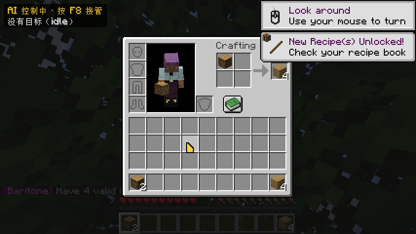
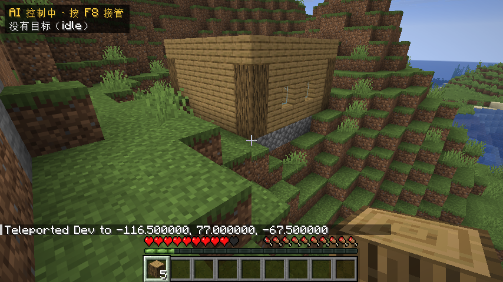

# Cogito（原型）

*An AI that plays Minecraft through a real client: plans, skills, reflexes and vision, with the person able to take back control at any time. NeoForge 26.1.2 and 1.21.1, client only.*

把一个真实的 Minecraft 客户端交给 AI 操作。适用于 NeoForge 26.1.2 和 NeoForge 1.21.1，只需装在客户端。

名字取自“我思故我在”（cogito, ergo sum），和编程法术的 [Logos](https://github.com/MagicFoxDemon/MinecraftLogosMod) 是一对：Logos 是写成法术的言语，Cogito 是会思考、会动手的玩家。0.2.0 及以前叫 AI Player，见[改名](#改名)。

- **真人随时能接管**：AI 控制时，真实键鼠被屏蔽，只有 F8 有效。真人可以一直看屏幕。
- **Mineflayer 式接口**：大部分操作走真实按键。合成、背包、箱子、交易都打开真实界面，光标逐格移动。
- **游戏内 computer use**：接口没有定义的东西，AI 可以看屏幕、移动光标、点击和打字。
- **物品使用声明**：mod 可以直接写说明和动作，告诉 AI 物品或方块怎么用。
- **分层 Agent**：规划层、校验层和可替换的执行层。外部 AI 可以通过 MCP 下达短期或长期目标。
- **不用模型的技能**：`obtain minecraft:iron_pickaxe` 一条调用就能从空手一路做到铁镐，中间不调用模型。
- **蓝图建造**：规划层读取游戏目录里的蓝图，或者自己按调色板分层设计。看过材料和耗时的统计后自己决定建不建，之后的收集和建造都由代码完成。
- **不靠模型的反应层**：反击、逃跑、进食、上浮换气、爬出岩浆、自动重生。
- **看得见**：规划和执行都会收到游戏画面，不用模型主动要求。
- **可选的数据集模块**：AI 玩的时候把 VLA 训练数据传到对象存储。它是单独的 mod，不在这个仓库里，见[训练数据](#训练数据)。



## 安装

1. 构建对应版本的 jar 放进 `mods`：26.1.2 是 `build/libs/cogito-0.3.0.jar`，1.21.1 是 `versions/1.21.1/build/libs/cogito-0.3.0+mc1.21.1.jar`。jar 约 116MB，几乎全是三家的 SDK：OpenAI 的约 75MB，Anthropic 的约 39MB，Gemini 的连同 Google 的依赖约 12MB。
2. 可选但推荐：把对应版本的 Baritone 也放进 `mods`：26.1.2 用 `libs/baritone-api-neoforge-1.18.0.jar`，1.21.1 用 `libs/baritone-api-neoforge-1.11.3.jar`。没有它时 `goto` 只能直线走，`collectBlock` 不可用。
3. 在游戏里按 F9（或者模组列表里 Cogito 的“配置”按钮）打开模型设置，选提供商、填密钥。见下面的[模型提供商](#模型提供商)。

```bash
./gradlew build
```

开发运行和用打包 jar 冒烟测试：

```bash
./gradlew runClient
```

```bash
./gradlew runClient -PtestBuiltJar
```

按朋友安装的样子测发行版：全新的游戏目录 `build/release-test/game`，只从它的 `mods` 文件夹加载 jar（本体和 Baritone 要先放进去），不读开发用的 `.env`，没有开发开关，设置目录也是单独的 `build/release-test/settings`，不碰 `%APPDATA%` 里真正的设置。数据集模块不加载：

```bash
./gradlew runClient -PreleaseTest
```

发行时只需要本体 jar 和 Baritone jar。`cogito-api` jar 是给其他 mod 编译用的，玩家不需要。

### 多个 Minecraft 版本

仓库根目录构建 26.1.2，`versions/1.21.1/` 构建 1.21.1。两边共用 `gradle/cogito.gradle`，上面的命令都能用，只是要加 `-p versions/1.21.1`：

```bash
./gradlew -p versions/1.21.1 build
```

```bash
./gradlew -p versions/1.21.1 runClient "-PquickPlay=AI Test 1_21_1"
```

`-PquickPlay=<存档>` 让开发运行直接进那个存档，两个版本都能用。1.21.1 的开发运行目录是 `versions/1.21.1/run`，MCP 端口设成 25602（26.1.2 的是 25601，真正实例的是默认的 25599）。

代码的分法：两个版本都能原样编译的代码放在 `src/main`。两个版本写法不同的部分，放在 `versions/<版本>/src/main` 里，类名相同，大多在 `dev.cogito.compat` 下：`Mc`（id、维度、时间、选中格、高度、标签、燃料、穿戴、槽位点击、NBT、按键绑定）、`Input`（键鼠事件）、`Recipes`（配方从哪来）、`Frames`（截图）、`Canvas`（界面提示）、`Widgets`（设置界面的按钮和滚动）。输入相关的 mixin，以及 `MinecraftMixin` 和 `ClientPacketListenerMixin`，也是每个版本各一份。共用代码只调用这些类，所以加一个版本主要是写一份新的 `versions/<版本>/`。

每个版本的 `gradle.properties` 写着它和别的版本不一样的地方：Minecraft、NeoForge、Java 版本，对应的 Baritone，以及游戏自带的库（`game_libs`）。这些库不打进 jar，编译和运行都用游戏的版本。1.21.1 自带的 Guava、Gson、httpclient 比 SDK 要的旧，SDK 在这些旧版本上实测能用。数据集模块只接在 26.1.2 上。

测试多人路径时，先让第一个客户端开放局域网（`/publish true survival 25565`），再运行第二个客户端。它用 `run2` 目录和玩家名 `Bot2`，`run2/cogito/config.json` 里要把 `mcpPort` 改成别的端口：

```bash
./gradlew runClient2
```

## 使用

| 操作 | 效果 |
| --- | --- |
| 按 F8 | 在真人和 AI 之间切换控制权。可在按键设置里改绑定 |
| 按 F9 | 打开模型设置。只有真人控制时有效；AI 控制时这个界面会被拦下，不让 AI 碰到密钥 |
| 聊天框输入 `!ai 目标` | 设定短期目标并交给 AI。这条消息不会发到服务器 |
| 聊天框输入 `!ai long 目标` | 设定长期目标 |
| 聊天框输入 `!ai stop` | 取消当前目标和队列 |

真人按 F8 拿回控制权后，AI 和外部程序都不能抢回来，只有真人能再交出去。运行中的步骤会暂停，交还后重新开始这一步。

### 让外部 AI 接入（MCP）

mod 启动后在 `http://127.0.0.1:25599/mcp` 提供 MCP 服务（Streamable HTTP）。令牌在 `<游戏目录>/cogito/mcp_token.txt`。

```bash
claude mcp add --transport http minecraft http://127.0.0.1:25599/mcp --header "Authorization: Bearer 你的令牌"
```

外部 AI 通常只需要 `set_goal`、`get_state`、`get_plan`、`get_events`、`get_screenshot` 和 `cancel`。人格和长期关系留在外部，mod 只管玩游戏。想亲自操作时也可以用 `api`、`screen`、`usage`、`memory`，不过 Agent 执行目标期间，会动到身体的调用都会被拒绝。`chat` 和 `whisper` 例外，所以外部 AI 的人格可以一边让 Agent 干活一边说话。

### 目标

`set_goal` 的参数：

| 参数 | 取值 | 效果 |
| --- | --- | --- |
| `horizon` | `short`（默认）、`long` | 见下表 |
| `mode` | `replace`（默认） | 丢掉其他所有目标 |
| | `queue` | 排队 |
| | `interrupt` | 马上做，做完回到被放下的目标 |
| `steps` | 步骤列表 | 外部 AI 自己的计划，跳过规划层，恢复时从做到的那一步继续 |
| `executor` | `llm`、`vla`、`scripted` | 这个目标用哪个执行层 |

| | 短期目标 | 长期目标 |
| --- | --- | --- |
| 什么情况算放弃 | 累计重新规划超过 `maxReplans` | 只有连续失败、又一步都没做成才算；走完一轮计划，或者失败前做成了哪怕一步，都会清零。原地打转由花费上限兜底 |
| 花费上限 | `maxGoalCostUsd`（$1） | `maxLongGoalCostUsd`（$10） |
| 规划方式 | 能看多远规划多远 | 明确要求每次只规划下一个里程碑 |
| 排队时 | 按顺序 | 在步骤之间让路给排队的短期目标 |

目标按存档和服务器保存在 `cogito/worlds/<世界>/goals.json`，每次变化都写盘。崩溃、重启、被踢、换世界都不会丢，回到这个世界时自动继续，但仍然要真人按 F8 交出控制权才会开始动。

### 模型提供商

规划层和执行层各自选一个提供商、一个模型和思考强度，可以不一样，比如规划用强模型、执行用便宜的看图模型。提供商有三类，每类都走厂商自己的 Java SDK：

| 类型 | SDK | 能接什么 |
| --- | --- | --- |
| Anthropic | `com.anthropic:anthropic-java` | Claude。自适应思考、思考强度、结构化输出、提示缓存都用上了 |
| OpenAI 兼容 | `com.openai:openai-java`（Chat Completions） | OpenAI，以及所有兼容它接口的服务：中转、Ollama、LM Studio、vLLM、其他厂商的兼容接口。填接口地址即可 |
| Gemini | `com.google.genai:google-genai` | Google Gemini。思考摘要和思考签名会原样传回 |

同一类可以加多个，比如两个 OpenAI 兼容的服务器。

**设置界面**（F9，或模组列表里的“配置”）：上半部分选每一层用谁，下半部分编辑每个提供商：名称、接口地址、密钥、密钥环境变量、是否发图片、价格。“测试连接”会列出这个密钥能用的模型，并让用到这个提供商的那一层的模型回一个词。点“保存”才写入。真人发 `!ai` 时如果缺密钥或模型，目标不会开始，而是直接打开这个界面并说明缺什么。

**密钥存放**参考了 Logos 书灵：不放在游戏目录里，也不从游戏目录读。设置和密钥都在用户自己的设置目录（Windows 是 `%APPDATA%\cogito\llm.json`，macOS 是 `~/Library/Application Support/cogito`，Linux 是 `~/.config/cogito`），所以打包分享整个实例不会带上密钥。JVM 参数 `-Dcogito.settingsDir` 可以改位置，开发运行用的是 `AIplayer/dev-settings`。密钥在界面上显示为星号，存下后只显示最后 4 位，日志里也不出现。

密钥按顺序找：

1. 界面里存的密钥
2. 提供商填的“密钥环境变量”
3. 只有接口地址留空（即厂商官方接口）时，才读厂商常用的变量：`ANTHROPIC_API_KEY`、`OPENAI_API_KEY`、`GEMINI_API_KEY` 或 `GOOGLE_API_KEY`。这样 OpenAI 的密钥不会被发到别人的服务器上

指向本地服务器的 OpenAI 兼容提供商可以不填密钥。

**兼容不同的服务器**：思考强度、结构化输出这类可选参数，如果服务器或模型返回 400 并点名拒绝，就去掉这一项重试一次，并对这个模型记住。“默认”这一档完全不发思考参数。规划层的答案除了用接口的结构化输出，也在提示里写明了格式；服务器忽略结构化输出、把 JSON 包在代码块或句子里时也能取出来。模型看不了图时关掉“发送图片”，图的位置会换成一句说明。

**价格**用于花费上限，单位是美元/百万 token。Claude 模型留空时用内置价格；其他模型留空时按偏高的 $2 / $10 估算，保证上限还能让目标停下来。免费的本地服务器填 0。

旧版本从 `config.json` 的 `plannerModel`、`executorModel`、`plannerEffort`、`executorEffort` 读模型，第一次打开时会沿用这些值；之后以设置界面为准。旧版本读的 `<游戏目录>/aiplayer/.env` 不再读取（改名后它会随文件夹搬到 `cogito/` 下），日志会提醒删掉它。

### 设置

`<游戏目录>/cogito/config.json`（模型和密钥不在这里，见上一节）：

| 字段 | 默认 | 说明 |
| --- | --- | --- |
| `executor` | `llm` | `llm`、`vla` 或 `scripted` |
| `vlaEndpoint` | 空 | VLA 模型的 HTTP 地址 |
| `allowMenus` | `false` | 允许 AI 操作世界之外的菜单。存档列表能删存档，所以默认关闭 |
| `allowExternalTakeover` | `false` | 允许 MCP 客户端把控制权交给 AI |
| `allowCommands` | `false` | 允许 AI 发 `/` 命令和编辑命令方块。私信除外 |
| `reflexes` | `true` | 反应层的总开关 |
| `legitMiningOnServers` | `true` | 在服务器上只挖看得见的矿，看不见就去矿层挖隧道找，不从区块数据直接定位。单人世界不受影响 |
| `planWithScreenshot` | `true` | 规划时附带当前画面 |
| `stepWithScreenshot` | `true` | 每步开始时附带当前画面 |
| `screenshotAfterActions` | `true` | 每轮动作之后附带新画面 |
| `autoScreenshotEdge` | `768` | 自动附带画面的长边 |
| `screenshotMaxEdge` | `1280` | 模型主动要截图时的长边 |
| `maxTurnsPerStep` / `maxReplans` | `30` / `6` | 单步和重新规划的上限 |
| `maxGoalCostUsd` / `maxLongGoalCostUsd` | `1.0` / `10.0` | 单个目标的估算花费上限，超出就停止 |
| `mcpPort` / `mcpEnabled` | `25599` / `true` | MCP 服务 |

## 架构

```text
外部 AI / 真人  --目标-->  规划层 Planner  --步骤+done_when+run-->  技能 Skills（不用模型）
                  ^             ^                                     |  做不完才往下
                  |             |                                     v
             事件、画面          |                          执行层 Executor（LLM 或 VLA）
                  |             +---- 校验层 Verifier 读游戏状态 <-----+
                  |                                                   |
                  |           语义接口 / 结构化数据 / 屏幕控制 / 使用声明
                  |                                                   |
                  +---- 反应层 Reflexes（每刻运行，可打断上面）----> 虚拟输入层 VirtualInput
                                                                      |
                                                                  游戏本体
```

| 目录 | 内容 |
| --- | --- |
| `control/` | 控制权和虚拟输入层，所有键鼠事件的唯一入口 |
| `mixin/` | 屏蔽真实输入、读取 F8、拦截 `/` 命令、读取原本不公开的游戏状态 |
| `bot/` | Mineflayer 式函数（`WorldFns`、`ActionFns`、`WindowFns`、`ExtraFns`）、技能（`Skills`、`Obtain`、`Sources`、`RecipeIndex`）、屏幕控制（`ScreenTool`）、mod 文本和配方（`ModText`、`MachineRecipes`） |
| `usage/`、`api/` | 物品使用声明，以及给其他 mod 用的 API：`AiUsage`（声明动作）、`AgentEvents`（观察 Agent 做了什么）、`AiTools`（添加 MCP 工具） |
| `agent/` | 规划、校验、执行、目标循环、反应层、外部工具、运行记录 |
| `memory/` | 经验和世界记忆 |
| `vision/` | 截帧 |
| `../cogito-dataset`（仓库之外） | 可选的数据集模块。放在项目旁边时，构建会把它当成第二个 mod 加载；没有它，构建和运行都不受影响 |
| `llm/` | 模型调用：三类提供商共用的对话接口（`Chat`、`Conversation`），各自的实现，设置和密钥（`LlmSettings`），用量和费用（`Llm`） |
| `mcp/`、`ui/` | MCP 服务；屏幕提示和模型设置界面 |
| `compat/`、`versions/<版本>/` | 各个 Minecraft 版本写法不同的部分，见[多个 Minecraft 版本](#多个-minecraft-版本) |

## 技能

大部分操作不需要每一步都问模型。技能是一整段不调用模型的逻辑，由基础函数组合而成，所以按的还是同样的键、开的还是同样的界面。模型只在开始时决定做什么，技能失败时才接手。

| 技能 | 做什么 |
| --- | --- |
| `obtain(item,[count])` | 拿到足够数量的物品：自动算出整棵依赖树（采集、工具、合成、熔炼、打猎）并全部做完。工具也在权衡之内：砍 20 根木头会先做斧子，砍 3 根不会 |
| `obtainPlan(item,[count])` | 只说 `obtain` 会怎么做，不动手 |
| `collectBlock(blocks,count)` | 找方块、走过去、挖、捡。没有合适工具时先去做一把 |
| `craftItem(item,[count])` | 找或放下工作台，走过去，合成，收回工作台。多件一起做：材料一次放够，按住 Shift 点一次产物，26 根原木变 100 块木板 6 秒 |
| `smeltItem(item,[count],[fuel])` | 找或放下熔炉，选燃料，等待，取出，收回熔炉。`item` 写投入物或产物都行 |
| `hunt(mob,[count])` | 追上去打死并捡掉落。只算真正打死的，传送走或消失的不算；够不着的跳过换下一只；血量 ≤ 8 时停手并说明 |
| `gatherFood([count])` | 打附近的动物直到有足够的食物 |
| `pickupItems([radius])` | 走过去捡地上的东西 |
| `sleepInBed()` | 走到床边睡到天亮，不让睡时说明原因 |
| `putInChest` `takeFromChest` `viewChest` | 走到最近的箱子或木桶，存、取、看 |
| `equipBestArmor()` | 每个部位穿上最好的盔甲 |
| `goToNearestBlock` `goToNearestEntity` `goToPlayer` `followPlayer` `moveAway` `goToY` `goToSurface` | 移动 |
| `brew(potion,[form],[count])` | 从零酿一瓶药水：倒推出从水瓶（或手头、箱子里现成的药水）到目标的整条链，瓶子、酿造台、烈焰粉和每种材料都用 `obtain` 去拿，逐步酿。`form` 是 potion、splash 或 lingering |
| `goToPlace(name,[range])` | 走到这个世界里记住的地点，比如 home |
| `gatherMaterials(name,[x,y,z],[rotation])` | 拿到蓝图还缺的材料，背包装不下时只拿能装下的 |
| `buildBlueprint(name,[x,y,z],[rotation],[gather],[timeout_s])` | 按蓝图逐层建完，材料不够时自己去拿，见[蓝图](#蓝图) |

**计划步骤可以直接跑技能。** 规划层给步骤写 `run`，比如 `{"fn":"obtain","args":{"item":"minecraft:iron_pickaxe"}}`。这一步就由代码跑完，再由校验层确认，不进入执行模型。代码没做完时，执行模型带着代码报告的情况接手。外部 AI 的 `set_goal` 也可以在 `steps` 里写 `run`，这样连规划模型都不用调用。VLA 执行层会忽略 `run`，自己玩。

**`obtain` 怎么工作。** 思路来自 AltoClef：每次根据实际背包算出最便宜的路线，只做第一块，然后重新算。所以工具断了、打了一架、甚至死了一次，都只是下一块不一样。配方来自游戏本身：单人世界包含所有 mod 的配方；服务器只下发已解锁的配方，原版配方就从游戏 jar 里读。挖矿和打猎的来源是内置的原版对照表。原版方块是否掉自己，读游戏 jar 里的掉落表，所以不会去挖不掉东西的玻璃。mod 方块看不到掉落表，默认掉自己。所需工具从方块标签读取。

**被反应层打断时**，技能等反应结束后从当前状态继续，不用模型介入。基础函数不会这样，它们报错后交给模型判断。

**长任务的自我照顾。** `obtain` 每做完一块就检查一次：身上没有吃的而 16 格内正好有牛羊鸡，就顺手打一只（每 3 分钟最多一次，免得追着动物跑）；饥饿到 12 以下还没吃的，找 32 格内的；到 6 以下就专门去找。手上没有剑而材料和工作台都在身上，就顺手做一把。背包快满时丢掉泥土、碎石这类杂物，免得挖矿无声地卡住。木头一次多带几个，免得到了地下又要回地面。

**工具。** 挖掘按游戏自己的公式算秒数：徒手砍一根原木 3 秒，木斧 1.5 秒，石斧 0.75 秒。`obtain` 把"先做一把工具"当成一个可选项连同它的代价一起比较，所以砍一片树会先做石斧，砍三根不会。石头徒手挖不掉东西，所以从来不会徒手挖。镐在半路坏了，Baritone 会继续徒手刨，这时 `collectBlock` 在 0.6 秒内停下来报 `no_tool`，`obtain` 重新规划，做一把新的再继续。放下的工作台和熔炉用完会挖掉捡回，掉落物还没出现时等一下，站在旁边捡不到就踩上去。

**熔炼时不干等。** `obtain` 把炉子点上就走：炉子里正在烧的东西算进规划用的背包，于是它接着做计划里现在就能做的事（挖沙、挖煤、砍树），直到某一步真的需要炉子里的产物，才回去等最早点的那个炉子烧完、取出来。要烧的多，就再做两个炉子一起烧，最多三个。`gatherMaterials` 收集多种材料时，石头在烧的同时去弄玻璃，最后一轮再把炉子里的都取回来并挖走炉子。

**箱子里的东西。** 单人世界里客户端就是服务器，附近 96 格内所有箱子、木桶、潜影盒的内容直接从服务器那边读；多人服务器上，打开过一次的箱子按位置记住内容，存在这个世界的记忆里（`worlds/<世界>/containers.json`），下次打开再更新。`obtain` 把"去某个箱子拿"当成一种来源，和挖、合成、熔炼放在一起比价（走过去的时间加开箱 3 秒），所以通常先拿箱子里的。到了发现东西没了，这个箱子的记录当场改掉，`obtain` 重新算。规划层的状态里有附近箱子的清单，也可以用 `findInChests` 问哪个箱子有什么。

**家。** 用蓝图建成第一栋房子时，它的位置记成 `home`，写进世界记忆，`goToPlace home` 能走回去。记忆工具多了 `forget`，AI 决定不要了就删；也可以用 `place` 记别的地方。

**酿造。** 药水不在合成表里：酿造台把一种瓶子变成另一种，一次一种材料。`brew` 从手头的瓶子（水瓶、背包和箱子里现成的药水）出发，用游戏自己的酿造规则向前搜到目标药水，得到一条链；每一步的材料用 `obtain` 去拿（先搜箱子），没有酿造台就做一个放下，没有水就从箱子里拿一桶倒出来再收回去，然后逐步酿。mod 加的药水在单人世界里一样能搜到；服务器上只认原版规则。

**给旁观者看的细节。** 走路时视线跟着方向转（Baritone 的 `freeLook` 关掉，`smoothLook` 打开），不再侧着走。什么都不做两秒后把视线放平，十秒后关掉被打断的动作留下的窗口。

**背包。** 36 格都占满时什么也合成不了，挖到的东西也只能留在地上。状态里的 `free_slots` 让规划层提前知道；合成前先算结果有没有地方放，没有就立刻报 `inventory_full`，`obtain` 不再把它当成走不通的路反复试。丢什么由模型决定：`dropItems` 接收它选的东西，转向最开阔的方向往斜上方扔，四周太窄就先走出去，扔掉的东西 10 分钟内不会被 `pickupItems` 捡回来。`toss` 和 `tossStack` 在背包界面里指着格子丢，手上拿着什么都不影响。`organizeInventory` 合并零散堆叠，把镐、剑、斧、铲、食物、方块、火把放到快捷栏，并指出哪些工具已经被更好的取代；`obtain` 在空位快用完时也会整理一次。镐放第 0 格是因为 Baritone 自己会把背包里的镐换到那里。

**食物。** 生肉的饱食度只有熟肉的约三分之一。进食反应层按饱食度加饱和度选最好的；只是为了回血而不是真饿时，只有生肉就先不吃，除非血量已经很低。`cookFood` 把身上的生食烤熟，多种食物会等熔炉空出来。`foodOptions` 列出身上的食物，以及用现有材料能做什么、能多得多少饱食度、会不会用掉金子这类更有用的东西。`obtain` 途中顺便处理：手边有熔炉和燃料就把生肉放进去，不停下手里的活，有工作台时也会把小麦做成面包。

**不用模型的代价。** 技能只有写死的逻辑。`obtain` 会把村庄的方块当成来源，比如拆掉村民家的门，它不懂这样不好。它不会下界和末地的路线，不会用村民交易和战利品箱，mod 机器也不认识。这些仍然要靠模型或物品使用声明。

技能的清单和实现思路参考了 [Mindcraft](https://github.com/mindcraft-bots/mindcraft) 的 `skills.js` 和 [AltoClef](https://github.com/gaucho-matrero/altoclef) 的任务目录，两者都是 MIT 许可，这里是用 Java 重新写的，没有复制代码。

## 蓝图

规划层有一个 `blueprint` 工具，所以建房子的流程是：先看蓝图和它要花多少，再决定做不做。



**蓝图从哪来。** 放在 `cogito/blueprints/` 里的文件，支持下载来的 `.litematic`、`.schem`、`.schematic`、`.nbt`，以及可以手写的 `.txt`。内置 `small_cabin` 和 `dirt_shelter`，同名文件优先。模型也可以自己设计，用调色板和分层切片写出来，保存成 `.txt`：

```text
description: 一间小屋
ground_layer: 0
palette:
c minecraft:cobblestone
O minecraft:oak_planks
D minecraft:oak_door[facing=north,half=lower]
U minecraft:oak_door[facing=north,half=upper]
layer 0
ccccc
c...c
ccDcc
layer 1
OOOOO
O...O
OOUOO
```

每层从下往上，每行从北到南，每行里从西到东。空格表示这格不动，`.` 表示清空。需要朝向的方块在调色板里写上状态。写错方块或字符会报错并指出第几层第几行。

**统计。** `blueprintInfo` 和保存蓝图时都会返回：尺寸，每种材料要多少、有多少、缺多少，能不能全部拿到（用 `obtain` 的规划器算），要采集的原料，大概几分钟收集、几分钟建造，能不能装下。如果有方块没有连到最底层，还会列出 `floating_blocks`，因为这些方块没有东西可以贴着放。规划层据此决定开工、换一个、改小一点，或者先做别的。

**怎么建。** 和 Mindcraft 的建造目标一样不用模型：比较世界和蓝图，缺什么拿什么，再继续。从最底层一层一层往上放，每次点击之前，先用物品自己的放置代码算出“从这个视角点这个面会放出什么”，所以楼梯、门、横放原木、上半砖不需要逐种写规则。先做站着就能做的，最近的优先，做不了才走到能放对的位置，放完读回来确认。Baritone 只负责走路，站的地方悬空时由它搭脚手架，建完自动拆掉。

| 函数 | 做什么 |
| --- | --- |
| `blueprintList()` `blueprintRead(name,[layer])` | 列出蓝图，读出整个蓝图或其中一层 |
| `blueprintInfo(name,[x,y,z],[rotation])` | 上面说的统计。给了坐标时只算那里还没完成的部分 |
| `blueprintSave(name,palette,layers,[description],[ground_layer])` | 保存自己设计的蓝图，并返回统计 |
| `findBuildSite(name,[radius],[rotation])` | 附近最平整的空地 |
| `buildStatus(name)` | 建到百分之几，哪些方块不对、哪些朝向不对 |

计划步骤用 `built <蓝图名> [百分比]` 判断是否建成，默认 100%。

**不拆自己的房子。** Baritone 挖最近的方块，分不清树上的原木和墙里的原木。所以在这个世界里开始过的蓝图，它们的方块都记着：要采集时如果最近的是自己建筑上的，就先走到最近的另一个；挖的时候发现准星落在自己建筑上，也会立刻停手。别人的建筑和真人盖的房子没有这种保护。

**为什么没用 Baritone 的建造器。** 一开始用的是它，实测有三个问题：它判断“能不能放”时，只看物品按玩家当前朝向放下的结果，所以有朝向的方块常被算成缺材料，然后暂停；替换地板时把格子挖开却不补上，在外面挖坑；一次测试中，门和玻璃板有一部分不知去向。改成逐块放之后，同一个蓝图全程没有卡顿，材料用量和统计一分不差。

**限制。** 没有连到最底层的悬空部分建不了，不会搭临时支撑。孤立的横放原木旁边没有方块可点时，只能竖着放，这类方块会算在 `facing_the_wrong_way` 里。双层台阶只会放一半。不支持把水抽干。告示牌的朝向和文字、箱子里的东西都不会还原。

## 反应层

模型一轮要几秒，岩浆和苦力怕不会等，所以这些事每个游戏刻在客户端线程上判断，不调用模型。AI 持有控制权时一直生效，有没有目标都一样。

| 情况 | 反应 |
| --- | --- |
| 在岩浆里、站在火里或岩浆块上 | 走向最近的安全落脚点，在液体里同时上浮。出来之前不被别的反应打断。有抗火效果时不触发；站在岩浆表面（比如 Logos 的水上行走）不算在岩浆里 |
| 水下且快没气 | 上浮，游向最近的水面 |
| 被打，或怪物在 5 格内且看得见 | 换上背包里最好的武器（不在快捷栏就先换过来），瞄准，攻击冷却满了才打 |
| 血量 ≤ 6（没有像样的武器时 ≤ 12）、苦力怕引信已点燃、7 格内有 4 只以上怪物、对手是监守者、铁傀儡或凋灵 | 朝安全方向跑开，一群怪时背离它们的中心。跑够距离（16 格或 8 秒）才停。四周都不安全时站住还手，不硬跑 |
| 饿了（饱食度 ≤ 6，或血量低且不饱） | 吃背包里最好的普通食物，吃完换回原来的快捷栏格 |
| 死亡 | 记下死亡地点和原因，通过真实按钮重生。极限模式不重生 |

它不会主动打其他玩家和未被激怒的中立生物，被玩家打也不还手，血量低时只会跑。反应一开始，正在进行的动作会以 `interrupted_by_reflex` 失败并说明原因，新动作等反应结束后才执行，执行层在下一轮会收到发生了什么。

**走向危险的地方要确认，不是禁止。** 模型用 `setControlState` 按住前进时，前面两步内有岩浆、火或超过 3 格的落差，调用会返回 `hazard_ahead`；走到半路才遇到，就松开前进并发一条事件。它可能确实想过去，比如身上有水上行走或抗火，这时带上 `confirm_hazard:true` 再按一次，这次按住期间不再拦。`status` 里的 `effects_seconds_left` 列出身上的效果。

这一层只处理近战和紧急求生。不会举盾、不会射箭、不会用法术、不会搭墙自保。骑乘、鞘翅飞行、睡觉、创造和旁观模式下不生效。

实测过打僵尸、苦力怕、不碰中立生物、进食、上浮、爬出岩浆、自动重生、打断动作、确认才走上岩浆、水上行走和抗火时不干扰。遇到监守者、铁傀儡和凋灵、极限模式这几个分支写了但没单独测。跑开和一群怪时的判断是在击败末影龙的长跑里加的，只在那次跑动里看过效果，不够精确：下界那段死亡仍然多，见下面的已知限制。

## 视觉和事件

Haiku 不会主动要截图：之前两轮机械动力测试一张都没看，还有一轮看了两张也照样说“已连接放好”。所以现在图片直接放进循环：

- 规划层每次规划都带当前画面。
- 执行层在步骤开始时和每轮动作之后都收到新画面，并被要求拿它对照自己的预期。
- 每轮工具结果之后，都附上这期间发生的事：受伤、死亡、反应层动作、聊天。别人说的话标记为 untrusted，只作为数据。

自动附带的图片长边是 768。实测“挖 5 个圆石再做石镐”的费用从约 $0.0035 涨到约 $0.0058。Baritone 的路径线和聊天提示已经关掉，不会出现在画面里。

## 记忆

| 范围 | 文件 | 内容 |
| --- | --- | --- |
| 整个客户端 | `cogito/experience/lessons.md` | 执行层报告的教训，一条一行，可以手改。重复的只加计数。标注适用范围（原版或 mod id），以及是否被游戏验证过 |
| | `cogito/experience/*.md` | 模型或真人写的经验笔记 |
| 单个世界 | `worlds/<世界>/progress.json` | 自动记录：已完成的进度、当前位置、第几天、身上的物品 |
| | `worlds/<世界>/places.json` | 自动记录床、死亡地点、传送门两端，模型也可以用 `place` 添加 |
| | `worlds/<世界>/people.json` | 自动记录玩家列表和附近的人、最后位置、最后说的话 |
| | `worlds/<世界>/journal.jsonl`、`notes/` | 目标和步骤的日志、世界笔记 |

世界键是 `sp-<存档名>` 或 `mp-<服务器地址>`。

规划时只放相关内容：按目标文字做关键词打分（中文按二字词匹配）选出最多 8 条经验，并滤掉当前没装的 mod 的经验，再加上当前世界的进度、地点、人物和最近日志。`memory` 工具的 `worlds` 可以查所有存档和服务器“玩到了哪里、认识了谁”，`search` 可以跨世界搜索。

关键词匹配不跨语言：用英文搜不到中文写的教训。死亡地点、手动地点、人物和进度都实测过，床和传送门的自动记录写了但没单独测。

## mod 接口：物品使用声明

一个 mod 的物品或方块怎么用，由 mod 作者自己写一份声明，AI 像读 Skill 一样读它的说明，像调工具一样调它的动作。规划层在规划前读说明，并把动作直接写进步骤的 `run`，整步不经过模型；执行层在不认识某个东西时先查它。不装 Cogito 也能带着声明，它只是 assets 里的一个文件；需要代码的动作也不用依赖 Cogito 的 jar。

在你的 mod 里放 `assets/<modid>/ai_usage/<名字>.md`。玩家也可以放进 `<游戏目录>/cogito/usage/`，同 id 时玩家的优先。

````markdown
---
id: mymod:flux_core
targets: item:mymod:flux_core, block:mymod:flux_press
summary: 给 Flux Press 充能，不是燃料
---
手持核心右键压机，再给压机红石信号。

```actions
{"charge": {"summary": "给压机充能", "params": ["x", "y", "z"],
  "steps": [{"fn": "equip", "args": {"item": "mymod:flux_core"}},
            {"fn": "activateBlock", "args": {"x": "$x", "y": "$y", "z": "$z"}}]}}
```
````

**文件格式。** 开头是 frontmatter：`id`（声明的 id）、`targets`（它属于哪些东西：`item:`、`block:`、`entity:` 加注册名，逗号分隔）、`summary`（一行摘要）、可选的 `handler`（下文的处理类）。正文是说明书，写清这东西是什么、怎么用、做完是什么样。末尾的 ```` ```actions ```` 块是动作：每个动作有 `summary`、`params`（参数名列表，或 `{"名字": "怎么填"}` 对象），要么给 `steps`（由本 mod 的函数组成，`"$x"` 这样的值换成调用时的参数），要么交给代码。`"read": true` 表示这个动作只读不动身体，规划层也可以直接调它。

**AI 怎么用它。** 状态里的 `usage_declarations` 列出当前相关的声明：身上有它的物品、附近有它的方块或实体，以及和目标文字匹配的（按 id、摘要、正文和目标在当前语言里的名字搜索，所以中文目标也能搜到）。方块类目标还带 `near`，写明 32 格内最近的那个在哪，没有 `near` 就是附近没有，这样规划层不用猜，也不会去拿第二台。规划层有 `usage` 工具：`list` 列全部，`search` 按词找，`read` 读说明书和动作参数，`invoke` 只能调 `read` 动作；要动身体的动作写进步骤的 `run`：`{"fn":"invokeUsage","args":{"id":"mymod:flux_core","action":"charge","args":{"x":1,"y":64,"z":2}}}`，由代码跑完再校验。执行层的 `usage` 工具多一个真正的 `invoke`。

**校验 mod 自己的状态。** `done_when` 原本只看得到背包和方块，看不到“术式在法杖上”或“机器在运转”。mod 可以提供一个只读动作，返回 `{"met": true}`，或 `{"met": false, "why": "还差什么"}`，规划层就能把它当条件写：`usage logos:spell_page has_spell {"on_wand":true}`。说明书里写明有哪些可以用。这种动作在校验时运行在客户端线程上，不能等待，也不能动世界。

**mod 动作能用的东西。** `placeNearby(item)` 把随身的机器放到手边并告诉你位置；`status` 的 `action_bar` 是快捷栏上方那行字，mod 常在那里说明为什么拒绝，它不再混进聊天事件。

**寻路和 mod 方块。** 原版 `isPathfindable` 对所有碰撞箱不是整格的方块都返回可通行，原版家具自己覆盖了这个方法，mod 的方块往往没有，Baritone 就会一直顶着走。所以 mod 里有碰撞箱又不是门、栅栏门、活板门、梯子、台阶、楼梯的方块，一律算障碍。所有 mod 的方块实体，以及箱子、熔炉、工作台等原版容器，Baritone 都不许破坏（设置的是 `blocksToDisallowBreaking`，只提高成本拦不住），`obtain` 也不把它们当来源，`collectBlock` 会立刻失败并返回 `kept_whole`。真要拿走就走到跟前用 `dig`，工作台和熔炉的收回走的就是这条路。

**自绘布局的窗口。** LDLib2 这类界面可能在 `Slot` 上留下错误的坐标（Logos 法杖窗口的背包槽算出来在屏幕外面）。窗口函数遇到屏幕外的槽位或最小化的窗口，就直接走游戏的槽位点击入口；屏幕工具对这样的槽位标 `off_picture`，不给错误坐标。

**需要代码的动作**，两种写法，都不需要 Cogito 装着才能编译：

1. 在 frontmatter 里点名一个类：`handler: com.example.mymod.compat.CogitoActions`，类里有一个公开静态方法，签名只用 Gson 和 JDK 的类型：

   ```java
   public static JsonElement invoke(String action, JsonObject args, BiFunction<String, JsonObject, JsonObject> game)
   ```

   `game.apply("goto", args)` 可以调 AI 的任何函数（见「接口覆盖」），返回 `ok`/`result` 或 `error`/`message`/`hint`。方法返回 JSON 结果；要失败就返回带 `error`、`message`、可选 `hint` 的对象，AI 看到的和本 mod 自己的失败一样。这个类只在装了 Cogito、动作真被调用时才加载，所以你的 mod 不依赖它的 jar。不需要游戏函数时可以省掉第三个参数。
2. 或者编译时依赖 `cogito-api-<版本>.jar`（`gradlew apiJar` 生成，只含 `dev.cogito.api`），在 `ModList.get().isLoaded("cogito")` 之后注册：`AiUsage.handler("mymod:flux_core", "charge", args -> ...)`；`AiUsage.call(fn, args)` 调 AI 的函数，`AiUsage.onGameThread(...)` 回到游戏线程。

两种写法的动作都在玩游戏的工作线程上运行，可以阻塞和等待；读写世界要回到客户端线程。动作名无论哪种写法都要写在 `actions` 里，说明书才知道有它。

`assets/minecraft/ai_usage/` 里有 4 个原版例子：工作台、熔炉、末影之眼（都是步骤），时钟（Java 处理函数）。第一份真正的 mod 声明在 Logos（[MagicFoxDemon/MinecraftLogosMod#419](https://github.com/MagicFoxDemon/MinecraftLogosMod/pull/419)，分支 `feat/aiplayer-usage`，等待合并）：`logos:inscription_table` 把法式编纂台的整个流程做成动作，`write_spell` 一句话让书灵写好术式并刻到载页上，`inscribe` 抄示例或写源码，`examples`、`check`、`ask_sage` 只读。走到台前、放页、取回都包含在动作里；附近没有台子但身上有，就放下用完再收回；没有空白页就自己 `obtain`。写入时会真的右键打开编辑器再关上，因为 Logos 的服务器只接受确实打开了界面的玩家发来的术式，这条检查和领地保护不绕过，被拒绝时返回游戏原话。`logos:spell_page` 说明载页品级和法杖：`hang_on_wand` 挂页（法杖满了可以用 `replace` 换下一张），`cast` 一步完成拿杖、选术式、瞄准、蓄满、放出，`read_pages` 和 `has_spell` 只读。处理类 `dev.logos.compat.aiplayer.AiPlayerActions` 用的就是第 1 种写法。

开发目录测 Logos 时，把 `run/mods` 里的 Logos 和它的四个前置（LDLib2、Photon、KilaGraph、GeckoLib）从 `.jar.disabled` 改回 `.jar`，`/logos kit` 需要 `config.json` 的 `allowCommands`。书灵走 OpenAI 兼容接口，用环境变量 `LOGOS_AI_URL`、`LOGOS_AI_MODEL`、`LOGOS_AI_KEY` 配置。

没有声明的 mod 内容，AI 按这个顺序摸索：`usage`、`modText`（mod 自己的语言文件）、`recipesFor` 和 `recipesUsing`、`describeBlock`（含方块实体数据）、屏幕。

## 接入 VLA

VLA 只替换执行层，规划、校验、记忆和外部接口都不用改。设置 `executor` 为 `vla`，`vlaEndpoint` 指向你的服务。mod 循环发送：

```json
{"instruction": "当前步骤的文字", "state": "状态 JSON 文本", "frame_png_base64": "640 宽的画面"}
```

服务返回接下来要播放的设备帧，每帧 50 毫秒：

```json
{"frames": [{"keys": [87], "buttons": [], "dx": 8, "dy": 0, "scroll": 0}]}
```

`keys` 和 `buttons` 是 GLFW 编码，表示这一帧按住哪些键。完成由校验层根据 `done_when` 判断，VLA 不需要自己报告。F8 同样能打断它。反应层触发时，这些设备帧会被丢弃。VLA 运行时不画 AI 横幅，画面里只有游戏本身。

### 训练数据

AI 玩的时候顺便产出 VLA 的训练数据，由单独的数据集模块完成，并传到对象存储。它是另一个 mod，目前不公开，不在这个仓库里；不装就没有这个功能，主 mod 不依赖它。

## 校验条件

规划层给每一步写 `done_when`，游戏状态满足时这一步才算完成：

```text
has_item <id 或 #标签> <数量>      has_at_most <id 或 #标签> <数量>
near <x> <y> <z> <半径>           moved <格数>
block_at <x> <y> <z> <id>         dimension <id>
y_below <y>      y_above <y>      health_at_least <n>      food_at_least <n>
window_open      window_closed    built <蓝图名> [百分比]
usage <声明 id> <只读动作> [参数 JSON]
```

步骤开始前条件就已成立的话，这一步会被跳过，并明确告诉规划层“什么也没做”。

每个目标的完整过程写在 `cogito/traces/<时间>.jsonl`：计划、思考摘要、模型回复、工具调用、图片、事件和费用。这些是本机的调试记录，不是数据集，不含画面。

## 接口覆盖

除特别说明外，全部在真实客户端里跑过，NeoForge 26.1.2.112。1.21.1（NeoForge 21.1.267）只跑过下面“测试过的端到端场景”里写明的部分。

| 分类 | 函数 |
| --- | --- |
| 读取 | `status` `inventory` `heldItem` `blockAt` `describeBlock` `describeItem` `modText` `blockAtCursor` `entityAtCursor` `findBlocks` `canSeeBlock` `canDigBlock` `digTime` `isABed` `entities` `nearestEntity` `players` `time` `getControlState` `waitForTicks` `waitForChunksToLoad` `recipesFor` `recipesUsing` `recipesAll` `window` `tabComplete` `getExplosionDamages` |
| 移动 | `setControlState` `clearControlStates` `look` `lookAt` `goto` `stopPathing` `mount` `dismount` `moveVehicle` |
| 技能 | `obtain` `obtainPlan` `collectBlock` `craftItem` `smeltItem` `brew` `hunt` `gatherFood` `pickupItems` `sleepInBed` `putInChest` `takeFromChest` `viewChest` `equipBestArmor` `goToNearestBlock` `goToNearestEntity` `goToPlace` `moveAway` `goToY` `goToSurface` `gatherMaterials` `buildBlueprint` |
| 蓝图 | `blueprintList` `blueprintRead` `blueprintInfo` `blueprintSave` `findBuildSite` `buildStatus` |
| 箱子和酿造 | `chestsKnown` `findInChests` `forgetChest` `brewPlan` `potions` |
| 方块 | `dig` `stopDigging` `placeBlock` `activateBlock`（含 `hold_s`） `useOn` `updateSign` `sleep` `wake` `setCommandBlock` |
| 实体 | `attack` `activateEntity` `activateEntityAt` `placeEntity` |
| 物品 | `setQuickBarSlot` `equip` `unequip` `toss` `tossStack` `consume` `activateItem` `deactivateItem` `swingArm` `fish` `writeBook` |
| 窗口 | `openBlock` `openChest` `openFurnace` `openContainer` `openVillager` `openInventory` `closeWindow` `clickWindow`（模式 0、1、2、4、6） `moveSlotItem` `transfer` `windowPut` `windowTake` `putAway` `craft` `trade` |
| 创造模式 | `creativeSetSlot` `creativeFly` `creativeFlyTo` |
| 其他 | `chat` `whisper` `respawn` `setSettings` |
| 屏幕控制 | `describe` `screenshot` `zoom` `mouse_move` `left_click` `right_click` `middle_click` `double_click` `left_mouse_down` `left_mouse_up` `left_click_drag` `scroll` `key` `hold_key` `type` `wait` `mouse_delta` |

`scroll`、`left_mouse_down`、`left_mouse_up` 和 `middle_click` 只确认事件送达，没有检查界面效果。

**写了但没单独测：** `elytraFly`、`goToPlayer`、`followPlayer`、顺手做剑、`acceptResourcePack`、`denyResourcePack`（要有下发资源包的服务器），以及与已测函数共用实现的别名 `openDispenser`、`openEnchantmentTable`、`openAnvil`、`openEntity`。

`setSettings` 只测过 `view_distance`。聊天框的 `!ai long` 写了但没单独测，同样的功能通过 MCP 测过。

## 已知限制

- **还不能通关**：击败末影龙的长跑（简单难度，死亡不掉落，6400 魔力）跑了约 6 小时、游戏里 16 天，最远到了下界要塞的烈焰人刷怪笼，没有拿到烈焰棒，见下表。Haiku 在长线上的问题很明显：装备磨坏了不及时补，不知道下界没有昼夜，打怪几乎不用法术。
- **下界很容易死**：那次长跑死了 24 次，13 次是岩浆和岩浆块。传送门出口恰好在玄武岩三角洲，岩浆怪成群、落脚的地方窄。反应层修过几轮，能修的是“别在这里犯错”，没解决“这里本来就难走”。死亡不掉落时只是费时间，掉落的话这条路线走不通。
- **闪现等位移术式没有落点判断**：模型让书灵写了一个闪现，朝岩浆田施放，传过去就掉进岩浆死了，还以为术式没生效。接口只报告“放出去了”，模型要自己判断落点。
- **还是会等炉子**：熔炼已经不站着干等了，但计划里没有别的事可做时还是要等（比如只差石砖）。附近没有沙子时会走很远去找。
- **箱子只认近处和看过的**：单人世界读的是周围 96 格已加载区块里的箱子；服务器上只记打开过的。别人的箱子和自己的一样会被拿，没有“这是谁的”的概念。酿造在服务器上只认原版规则，mod 的药水只在单人世界里能搜到。
- **工具权衡的盲区**：为了圆石不会先做石镐，因为"石镐需要圆石"在搜索里是个环，只能用木镐把 40 块圆石挖完。为了原木做石斧没有这个问题。走路和放工作台的真实耗时比估算的高，所以小活有时还是会先做工具。
- **放熔炉偶尔放不下**：在林子里的一次重跑中，熔炉连放 6 次都报“没有可以贴着放的方块”，于是放弃了玻璃，换成煤做火把。换个地方就能放，放置点的选择还不够好。
- **蓝图建造的边角**：悬空的部分建不了；放不对朝向的方块会按能放的方式放上，`buildStatus` 里能看到；清理建筑范围内的草和花会多走几趟。
- **单人世界的挖矿等于知道矿在哪**：Baritone 直接读已加载区块的数据，这也是钻石镐这么快的原因之一，不代表真人水平。服务器上默认只挖看得见的矿，慢一些。`findBlocks` 不受这个设置影响，模型调用它时仍能读到隐藏的矿。
- **没有声明的 mod 方块还没解决**：写了声明的 Logos 已经能靠一句话用起来。机械动力石磨没有声明，测试没通过，见下表。这些测试是在视觉接入之前做的，之后按你的决定暂停了，没有重测，所以不知道现在能不能过。
- **Logos 接口的边角**：术式放没放出去只能看效果，校验条件查不到；`range` 是估算，书灵写的慢速弹丸在 17 格外就散了，模型是打空之后才走近的；书灵的请求走它自己的接口，不计入这里的费用统计；只在单人世界测过，服务器上的书灵路径（服务器提供书灵时）没测。
- **多人只测过局域网**：用两个开发客户端测的，关了正版验证。没测过真正的专用服务器、正版验证、反作弊和整合包服务器。
- **多人服务器的配方（只限 26.1.2）**：服务器不把未解锁的配方和机器配方发给客户端。原版配方从游戏 jar 里读，所以不受影响；服务器改过的配方和 mod 配方在解锁前不可见，`machine_recipes` 为空，只能靠 JEI、mod 文本或看界面。
- **只在开发环境里装过**：0.2.0 发行版在全新的游戏目录里测过（只从 `mods` 加载），但这个目录还是由开发环境启动的，没有在启动器的正式实例里跑过。
- **窗口最小化时**：窗口尺寸变成 0，光标没有地方可去。画面还能截到；物品窗口的函数改走游戏的槽位入口，照常工作；屏幕工具的点击会返回 `window_minimized`，不再悄悄点空。自绘界面（比如 Logos 的编辑器）在最小化时只能等。
- **深水里寻路**：Baritone 找不到水下方块的路径，模型只能自己想办法。出生在海上时一个简单目标 150 秒也没做完。
- **VLA 没接真实模型**：接口和数据采集都是通的，只跑过内置的脚本策略，采集的数据还没用来训练过。
- **费用是估算**：按返回的用量和价格算，用于花费上限，不等于账单。Claude 以外的模型没填价格时故意估高，比如经 OpenAI 兼容接口跑 Haiku 时估成了实际的 20 多倍。
- **Gemini 只测过一个模型和两个短目标**：`gemini-3.8-flash`，见下表。更长的目标、Gemini 2.x（走思考预算而不是思考等级）、Vertex AI 都没测。
- **OpenAI 兼容只测过一个服务器**：用的是 Anthropic 的 OpenAI 兼容接口。它不支持列模型（要 Anthropic 的请求头），也没有提示缓存。OpenAI 本身、Ollama、其他厂商的兼容接口都没测。思考内容只认 `reasoning_content` 和 `reasoning` 两个字段。
- **1.21.1 测得比 26.1.2 少**：跑过的见下表。多人、蓝图建造、酿造、箱子、Logos、OpenAI 兼容和 Gemini、F8 接管和 F9 设置界面都还没在 1.21.1 上测过。1.21.1 没有能放布局的滚动区域，设置界面在这个版本上改成滚轮挪动内容、放不下的行藏起来，也没测过。1.21.1 上服务器会把全部配方发给客户端，所以这个版本在服务器上也能读到 mod 配方和机器配方。
- **换提供商时模型名不跟着换**：在界面里把某一层换到别的提供商，或者删掉它正在用的提供商时，模型框里还是原来的名字，要自己改。“测试连接”会报出来。

## 测试过的端到端场景

| 场景 | 结果 | 约花费 |
| --- | --- | --- |
| 1.21.1 开发运行，新建的森林世界（简单），全程通过 MCP | 第一次让 Baritone 挖东西时游戏卡死不动：它要先读原版数据包算方块掉落，读完的最后一步排在游戏线程上，可它正是在游戏线程上等这一步。现在挖之前先在工作线程里把这份数据读好（两个版本都这样做）。之后：屏幕工具点过引导页、标题页和建世界页，打字、Esc 都送到了，截图颜色正常，提示条和 AI 光标画出来了。不用模型的 `obtain`：空手到木镐 43 秒，接着石镐 40 秒、两块木炭 76 秒（建熔炉、做木斧、放燃料、取出）；`recipesFor` 读出合成和熔炼配方，`potions`、`findBlocks`、`status`（群系、时间）正常。Haiku 目标“做个箱子放在旁边，把石镐放进去”：一次规划、三步完成 | $0.0037 |
| 1.21.1 发行版（`-PreleaseTest`）：全新游戏目录，`mods` 里只有本体和 Baritone 1.11.3，密钥只来自启动进程的环境变量 | 42 个库都从 jar 里加载。目标“打招呼，再说站在什么群系”：规划层看着画面说了“snowy spruce hills”，聊天里发了 Hello 和 grove | $0.0029 |
| 改成多版本之后的 26.1.2 开发运行（`AI Test A`） | 配方、空手到木镐 57 秒、截图和提示条都正常；打包的库和改之前一样 | $0 |
| 三类提供商：每类跑同样两个目标，一个只用执行层（给定一步：读位置、发聊天、`finish_step`），一个只用规划层（“打个招呼再说背包还剩几格”） | Anthropic（Haiku 5.5，密钥来自环境变量）：两个都完成，思考、工具、结构化计划正常，执行层每轮约 1.07 万 token 读自缓存，$0.0056。OpenAI 兼容（Anthropic 的兼容接口，同一个 Haiku）：两个都完成，没有参数被拒，没有缓存。Gemini（本地模仿服务器）：两个都完成；核对了请求：密钥走请求头，工具都带 JSON schema，画面作为 PNG 内嵌，模型那一轮连同思考摘要和思考签名原样传回，函数结果放在 `output` 下，规划层带 `application/json` 和计划的 schema | $0.006 / 实际约 $0.006（估算 $0.14）/ $0 |
| 真实 Gemini：真人在设置界面填了密钥，两层都用 `gemini-3.8-flash`，跑上面同样两个目标 | 两个都完成，没有参数被拒。执行层第二轮有 6893 token 读自 Gemini 的隐式缓存；同一轮里函数结果后面跟画面，接口接受；规划层同时带工具和结构化输出，直接给出 JSON 计划，并返回了思考摘要（执行层低强度时没有） | 估算 $0.088（没填价格，按偏高价估） |
| 模型设置界面，全程用真实的窗口消息操作 | 切换编辑对象、给两层换提供商、填接口地址和密钥环境变量，密钥那一行随输入更新来源；“测试连接”：Anthropic 列出 14 个模型，OpenAI 兼容的模型回了 OK（列模型被那个接口拒绝，界面照实显示），Gemini 列出 1 个能生成的模型并回了 OK。保存后的文件里没有密钥。加一个没密钥的 Gemini 给规划层，真人发 `!ai hello`：目标没开始，控制权留在真人，界面打开并说明缺密钥。删掉它后规划层回到第一个提供商。AI 控制时拦下这个界面的那段代码没有单独测 | $0 |
| 0.2.0 发行版（`-PreleaseTest`）：全新游戏目录，`mods` 里只有本体和 Baritone，密钥只来自环境变量 `ANTHROPIC_API_KEY`，界面是中文 | 加载的只有这两个 mod 和 jar 里的 44 个库。F9 打开设置，显示密钥来自环境变量；真人在聊天里输入 `!ai 在聊天里打个招呼`，AI 接管、规划并说了“大家好！”，$0.0028；执行层目标带画面完成，两个合计 $0.0045。打包前查过整个 jar（含里面的库）：没有开发 `.env` 里的任何值、本机路径、邮箱，也没有数据集模块 | 约 $0.0045 |
| 打包 jar（`-PtestBuiltJar`）：规划层用 OpenAI 兼容，执行层用 Gemini 模仿服务器，再在界面里测 Anthropic | 三家 SDK 及其依赖都从 jar 里加载，两个目标完成，Anthropic 列出模型 | 实际约 $0.003 |
| Haiku 5.5 + Logos，长期目标：“击败末影龙”（简单难度，死亡不掉落，6400 魔力，禁用命令） | **没有完成**，约 6 小时后由真人结束，游戏里第 16 天。自己做到：全套铁甲和盾、钻石镐、挖 10 块黑曜石、搭传送门点火进下界、走到要塞、找到烈焰人刷怪笼（下界要塞成就）、交手后被烧死，正在准备抗火药水。烈焰棒 0，末影珍珠 1。死 24 次，13 次是岩浆和岩浆块。期间修了十几处问题，并手写了几条关于下界的经验 | 约 $0.7 |
| 只用函数：走向岩浆的确认 | 没确认：离岩浆约 2 格停下并发事件，再按返回 `hazard_ahead`。水上行走加确认：站在岩浆表面走，反应层不干扰。抗火加确认：待在岩浆里不被拉走。都没有：离岸约 3 格时从 20 血掉到 3 血爬出来 | $0 |
| 只用函数：副手有盾牌时写载页 | 还有别的载页、只剩这一张、背包快满，三种情况都在 5 秒左右写完拿回，盾牌回到副手。修之前返回 `page_stuck`：`unequip off-hand` 实际是主副手互换，且副手有东西时潜行右键到不了台子。Logos 那半在 MagicFoxDemon/MinecraftLogosMod#420，没合并之前官方版本还有这个问题 | $0 |
| 只用函数：背包和食物 | 36 格占满时合成和 `obtain` 都在 0.5 秒内报 `inventory_full`；`dropItems` 2.5 秒丢掉 3 种东西，落在 3.6 到 4.2 格外，手上的东西没变，`pickupItems` 不捡回；关在石头盒子里时先挖出 8 格再丢。`organizeInventory` 合并 3 组堆叠，快捷栏排好。`cookFood` 一个熔炉烤两种食物 29 秒。受伤不饿且只有生肉时不吃，给了熟肉马上吃 | $0 |
| Haiku 5.5 + Logos：“用法式编纂台把爆炎火球这个示例术式写到一张载页上” | 16 秒，3 次请求。规划层调 `examples` 查到 id，一步 `inscribe`，全程没打开编辑器；写出的载页在编辑器里能正常打开，节点图完整 | $0.005 |
| Haiku 5.5 + Logos + 书灵：“让书灵帮我写一个受伤时给自己回血的术式，写到载页上，再挂到法杖上” | 22 秒，3 次请求，全程没有执行模型。`write_spell` 加 `hang_on_wand`，校验条件用 mod 自己的 `has_spell` | $0.004 |
| Haiku 5.5 + Logos + 书灵：“把爆炎火球写到载页上挂到法杖，用它打那头牛，打死后捡起掉落物” | 65 秒，10 次请求。写页、挂杖、施放都由代码完成；书灵的弹丸在 17 格外散了，模型看实体血量发现打空，自己走近补刀，再走过去捡牛肉和皮革 | $0.009 |
| Haiku 5.5 + Logos：“给我做一张写着爆炎火球的载页，编纂台要自己做”（只给纸、金粒、书与笔、讲台） | 38 秒，3 次请求。`obtain` 合成编纂台，动作自己放下台子、写完收回 | $0.005 |
| Haiku 5.5 + Logos，没配置书灵：“让书灵写一个火球术式” | 28 秒，6 次请求。收到 `sage_unavailable` 后重新规划，改抄示例完成，并说明不是书灵写的 | $0.010 |
| Haiku 5.5 + Logos，变基到最新 `main` 之后（开 PR 前） | 书灵写并挂杖 23 秒，2 次请求，$0.004；写、挂、打死牛、捡掉落物 45 秒，7 次请求，$0.007。`main` 新增了“必须打开界面”的检查，写入因此改走真实编辑器；魔力条移到客户端 HUD，改从 `mana_hud` 读。Logos 113 个单元测试和 1250 个世界内测试通过 | $0.011 |
| 已在目标范围内的 `goto` | 修之前：Baritone 一个 tick 就结束，判断没赶上，2 秒内就误报“120 秒没走到”，模型还把它记成了教训。修之后站在台子旁的坑里连测 10 次，0 失败 | $0 |
| Logos 接口的失败情况 | 冒险模式下被拒绝并返回游戏原话、法杖满了（列出已有术式）、用 `replace` 换下一张、台上已有载页先取回、坐标过期就找最近的、编译错误原样返回、魔力不足返回游戏原话（“需要注入 90，当前 15.20”）、被动术式提示不用施放 | $0 |
| 寻路和 mod 方块 | 修之前：贴着编纂台走不动，`goto` 超时，`obtain` 想挖现成的台子卡了 139 秒。只改成障碍之后：寻路会把台子挖穿捡走。改成禁止破坏之后：两个方向都绕过去，2 到 3 秒，台子完好。工作台和熔炉照常放下收回，路上的箱子没动 | $0 |
| Haiku 5.5 + 箱子 + 酿造：你布置的存档，“从箱子里找材料，做一瓶滞留型延长隐身药水” | 规划层 7 秒定计划，一步 `brew`。285 秒完成，2 次请求：瓶子从箱子里的沙子烧出来，水从箱子里的水桶倒出来，酿造台和烈焰粉从烈焰棒做，金胡萝卜从原金熔炼，发酵蛛眼从蛛眼、甘蔗、蘑菇合成，六步酿完。12 个箱子一个没坏，工作台和酿造台都收回了。存档里没有棕色蘑菇，是我在副本里补的；没补之前它在那一步停下，报“没有棕色蘑菇的来源” | $0.0032 |
| Haiku 5.5：“把这里记成家，走开 15 格再回来，回来后忘掉家” | 36 秒，7 次请求：执行模型用记忆工具 `place` 记下，`moveAway`，`goToPlace home` 走回，再用 `forget` 删掉，`places.json` 清空 | $0.0094 |
| 只用技能：熔炼不干等 | `obtain` 40 块石砖（给圆石和煤）：原来一个炉子烧 409 秒；现在分三个炉子，其中一个现做现放，140 秒，炉子收回。`gatherMaterials` 要 18 石砖和 2 玻璃板：石头在烧的同时去烧玻璃，222 秒 | $0 |
| 只用技能：观看者提的五个问题修完后各测一次 | 20 根原木：先做木镐、挖 3 块圆石、做石斧，再砍；快坏的木镐：坏后 0.6 秒停下，做新的再挖完 12 块；100 块木板 6 秒；做木镐用的工作台最后在背包里；身上没吃的、牛在 5 格内：做木棍时顺手打了，背包多了牛肉；走路时朝向和位移方向一致，看天后 4 秒视线放平 | $0 |
| Haiku 5.5 + 蓝图，空背包：“盖一间能住人的小木屋，要有门、窗户和屋顶”，最后一次 | 规划层 5 秒定计划，2 次请求。收集 13 分钟，914 秒开工。真人中途按 F8 开了死亡不掉落再交回，最终建成 | $0.0015 |
| Haiku 5.5 + 蓝图，空背包：“盖一间能住人的小木屋，要有门、窗户和屋顶” | 规划层先用工具查了 `small_cabin` 的统计（6 分钟能收齐），直接采用，两步：`gatherMaterials` 再 `buildBlueprint`。3 次请求。1200 秒超时时建到 96%，因为收集原木时把自己墙上的原木砍了（已修，现在不碰自己的建筑）；补一根原木后建完，见上图 | $0.0036 |
| 同上，修完上面的问题后在新世界重跑（云杉林，附近没有沙子） | 规划层 3 秒查完统计、5 秒给出同样的两步计划，2 次请求。收集用了 13 分钟：木头、圆石、门、火把都齐了，玻璃一开始拿不到，因为熔炉连放 6 次都“没有可以贴着放的方块”而放弃；建造阶段自己补收集时找到了沙子，烧出玻璃板。914 秒开工，957 秒时真人按 F8 接管，建到 7% | $0.0015 |
| Haiku 5.5 + 蓝图：“自己设计一座小石屋，楼梯尖顶，有门窗” | 规划层一次写出 7×8×7、262 块的设计，统计说要收集 55 分钟，它判断可以接受就开工。1700 秒超时时还在烧石头。之后把材料给它，建造 4 分钟建完，尖顶楼梯朝向全部正确 | $0.0074 |
| Haiku 5.5 + 蓝图：“天快黑了，只有两分钟，我什么都没有” | 规划层选了最便宜的 `dirt_shelter`（55 泥土，2.3 分钟），8 秒开始挖土，73 秒开工建，150 秒时按你的要求取消 | $0.0015 |
| 只用技能，真实世界，空背包：`buildBlueprint dirt_shelter` | 139 秒，自己选址、挖土、建完，0 次请求 | $0 |
| 只用技能，平台上，材料给齐：`small_cabin`（172 块，有门、玻璃板、火把）和一个 24 种朝向方块的测试蓝图 | 各约 3 分钟建完，材料用量与统计一致，朝向全对。`.nbt`、`.schem`、`.litematic` 三种格式读出的内容相同 | $0 |
| Haiku 5.5 + 技能，空背包：“做一把钻石镐” | 272 秒完成。规划层 2 次请求，执行模型 0 回合，木镐、石镐、熔炉、炼铁、铁镐、挖钻石都由代码完成 | $0.0018 |
| Haiku 5.5 + 技能，空背包：“挖 5 个圆石，然后做一把石镐” | 75 秒完成，4 次请求。其中 2 回合是放置工作台的 bug 转给了模型，这个 bug 已修，修后没有重测这个目标 | $0.0036 |
| 局域网第二个客户端，只用技能，空背包到石镐 | 66 秒，0 次请求，用游戏 jar 里的 1515 条原版配方 | $0 |
| 局域网第二个客户端，只用技能，继续做铁镐 | 途中被僵尸打死一次，重生后自己从头再来，只挖看得见的矿，最终做出铁镐。0 次请求 | $0 |
| 打包 jar + 默认设置，只用技能：`obtain` 熔炉 | 68 秒，0 次请求，真人 F8 交出控制权 | $0 |
| 单项技能各跑一次 | 合成、熔炼、打猎、捡东西、箱子、穿甲、睡觉、移动都成功；反应层打断后自动续做；没镐时先做镐 | $0 |
| Haiku 5.5：“挖 5 个圆石，然后做一把石镐”，带视觉，有技能之前，开局给了木镐和工作台 | 44 秒完成，10 次请求。模型从画面和结果发现挖到的是泥土，自己纠正 | $0.0058 |
| 同上，接入视觉之前 | 约 45 秒完成 | $0.0035 |
| Haiku 5.5：用切石机切 4 个石台阶，接入视觉之前 | 打开界面、放入石头、点中配方按钮，约 30 秒 | $0.0075 |
| 打包 jar + 默认设置：合成一个橡木按钮 | 12 秒完成，真人 F8 交出控制权 | $0.0033 |
| 出生在海上：同样的石镐目标 | 模型从画面判断“还在海面上”，决定走向岸边，150 秒时被我取消 | $0.0069 |
| 用木镐挖黑曜石（注定失败） | 22 秒报告失败并写下教训，下一个目标的计划用上了这条教训 | $0.0053 |
| 机械动力石磨：不给齿轮 | 240 秒超时，没有产出 | $0.0335 |
| 机械动力石磨：给齿轮，共 2 次 | 165 秒超时，没有产出。都把曲柄放在齿轮旁边，而不是上面 | $0.02 左右/次 |
| VLA 接口（内置脚本策略） | 只发设备帧，由校验层判定完成 | $0 |
| 真人 F8：AI 走路途中打断 | 动作立刻停止，Baritone 取消，外部无法抢回 | $0 |
| 目标调度（脚本策略） | 插队后回到原步骤、短期目标在步骤间插入、按 id 取消 | $0 |
| 崩溃恢复：运行中强杀进程 | 重启后目标自动恢复 | $0 |
| 局域网：第二个客户端以 `Bot2` 加入 | 合成、行走、放置、挖掘、双向聊天、被玩家打不还手、被踢后目标保留、重连后恢复 | $0 |
| 反应层 | 僵尸打死、苦力怕没掉血解决、中立生物没碰、吃到背包深处的面包、上浮换气、爬出岩浆、死亡后自动重生 | $0 |

## 改名

0.2.0 及以前叫 AI Player，0.3.0 起叫 Cogito。mod id 从 `aiplayer` 改成 `cogito`，Java 包从 `dev.aiplayer` 改成 `dev.cogito`，给其他 mod 编译用的是 `cogito-api` jar。

- **旧数据自动搬家**：第一次启动时，游戏目录里的 `aiplayer/`（配置、记忆、目标、记录）搬成 `cogito/`，用户设置目录里的 `aiplayer`（模型设置和密钥）也搬成 `cogito`。只在新文件夹还不存在时搬，搬的是原文件夹，不复制。
- **按键要重新绑定一次**：按键的名字变了，改过的 F8、F9 会回到默认。
- **旧 jar 要删掉**：`aiplayer-*.jar` 和 `cogito-*.jar` 不能同时放在 `mods` 里，否则会有两个 AI 同时运行。
- **其他 mod 不用改**：物品使用声明的格式和 `ai_usage` 文件夹名没变，Logos 的声明照常加载。

## 许可

Cogito 以 [MIT 许可](LICENSE) 发布。

`libs/` 里的 Baritone 是 [cabaletta/baritone](https://github.com/cabaletta/baritone)，以 LGPL-3.0 许可原样附带，见 [libs/README.md](libs/README.md)。打包进 jar 的三家模型 SDK 及其 44 个依赖各自保留原来的许可，主要是 Apache-2.0，也有 MIT 和 BSD-3-Clause。其中 28 个 jar 里没有附带许可文件，正式发布 jar 之前要补一份第三方许可清单。
